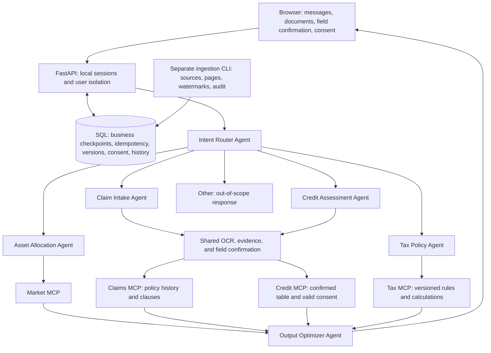

# Finance Agent · Financial Workflow Workbench 🧾

[中文](README.md) · English

A local personal project for financial workflows. Users ask questions, upload documents, confirm fields, and grant consent in a browser. FastAPI, LangGraph, and MCP connect the business steps while preserving evidence, calculations, historical results, and recovery options.

The project handles five intents: investment consultation, insurance claims, loan applications, policy/tax questions, and other requests. Six agents work with four local services built using the official Python MCP SDK. Automatic detection is an entry mode; clarification and waiting are workflow states, not additional intents.

The implemented scope is mainland China, CNY, published daily fund/ETF net asset values (NAV), and annual comprehensive income tax for resident individuals. Insurance samples and credit/risk assessment use explicitly marked synthetic data and rules. Asset allocation uses reproducible category templates. The project demonstrates workflows and engineering; it does not execute lending, insurance payouts, or return predictions.

## Implemented features

| Feature | Behavior and scope |
| --- | --- |
| Routing and follow-up | Detect or select one of five intents; clarify requests involving several businesses and preserve the original task during follow-up |
| Investment profile | Confirm amount, horizon, risk, liquidity needs, liabilities, existing assets, region, and fund codes before producing category allocations and historical NAV metrics |
| Claim intake | Upload PDF/PNG/JPEG documents, extract and confirm fields, retrieve the current user's policy history and versions, and screen coverage dates and clauses |
| Loan form | Prefill from multiple documents and user instructions, resolve missing/conflicting values, then require field confirmation and separate consent before creating a strict `CreditModelInput` table row |
| Loan reassessment | Copy a finished loan into a new application with documents and values retained, confirmation and consent cleared, and a parent-run link; preserve the original result |
| OCR evidence | Read native PDF text first; run RapidOCR ONNX on images and scanned pages without text; retain document, page, quote, coordinates, and confidence |
| Four MCP services | Market, claims, credit/risk, and tax; SDK `stdio` is the default, with identity, run ownership, and tool checks on both sides |
| Tax calculation | Retrieve verified official material by region, date, and version; calculate the seven-band resident annual tax using `Decimal` and retain citations |
| Data ingestion | Fixed public sources, pagination validation, overlapping collection windows, transactional upserts, incremental watermarks, and revision audits; failures do not advance watermarks |
| Recovery and isolation | SQL business checkpoints, request idempotency, version checks, revocable time-limited consent, and user isolation; paginated history, events, and JSON/Markdown reports |
| Output fidelity | Deterministic facts and calculations; optional model formatting may change only whitespace, paragraph breaks, and punctuation, otherwise the original conclusion is retained |
| Local operation | No frontend build step; offline read-only diagnostics, a Windows launcher, and a code verification script |

OCR never confirms financial fields automatically, and prompts cannot create consent. Financial amounts use `Decimal` on the server and strings in JSON and the browser.

## Workbench screenshots

These are actual screenshots from local browser verification on 2026-10-13 using synthetic material. The loan view shows simulated screening, principal-only monthly repayment, and a repayment ratio. The tax view shows annual tax and official citations. The current workbench interface is in Chinese.


## Stack and architecture

| Layer | Implementation |
| --- | --- |
| API and contracts | Python ≥ 3.11, FastAPI, Pydantic, Uvicorn |
| Workflow and protocol | LangGraph, FastMCP/ClientSession from the official Python MCP SDK, default `stdio` |
| Documents | PyMuPDF, RapidOCR, ONNX Runtime, Pillow |
| Storage | SQLAlchemy; SQLite by default, optional MySQL/PyMySQL |
| Optional model | DeepSeek HTTP adapter, structured validation, and rule fallback |
| Interface | Same-origin HTML, CSS, and JavaScript; no Node build step |
| Verification | pytest and Ruff; browser checks use Playwright/Edge and separately require Node and Playwright |



The six agents are Intent Router, Asset Allocation, Claim Intake, Credit Assessment, Tax Policy, and Output Optimizer. OCR, forms, SQL repositories, and ingestion jobs are shared tools or infrastructure. The four MCP services are project implementations using the official SDK, not official services operated by financial institutions.

When input is missing, the application saves a SQL business checkpoint. Follow-up checks identity, version, confirmation, and consent before re-entering LangGraph for the original business. This is application persistence; it does not use LangGraph's native `interrupt` or checkpointer. Each default MCP call starts an independent process; there is no connection pool. `inprocess` reuses the business checks for debugging without protocol transport.

## Quick start

Install Git, Python 3.11 or newer, and a browser. Python 3.13 is recommended; historical full verification used Windows CPython 3.13.9. SQLite is the default, so Docker, MySQL, and a model API key are unnecessary. Initial dependency installation needs internet access. Image/scanned-page OCR also needs usable local model files; first use may fetch models.

Run these commands in PowerShell 7 (`pwsh`) on Windows:

```powershell
git clone https://github.com/haihaihai112/finance-agent.git
Set-Location finance-agent
python -m venv .venv
.\.venv\Scripts\python.exe -m pip install -e ".[dev]"
Copy-Item .env.example .env
$env:LLM_ENABLED = 'false'
.\.venv\Scripts\python.exe scripts/doctor.py
.\scripts\start.ps1
```

Open the [workbench](http://127.0.0.1:8000) or [API docs](http://127.0.0.1:8000/docs). Press Ctrl+C to stop. Use `.\scripts\start.ps1 -Port 8001` for another port. The launcher uses the project `.venv`, runs diagnostics, and starts only if blocking checks pass. `LLM_ENABLED=false` explicitly enables rule mode without model API requests; you can also save it in your local `.env`.

After dependencies and OCR models are ready, demo documents, the verified snapshot, rule workflows, and local `stdio` MCP can run offline. The diagnostic itself reads local files, packages, configuration, and port status; it does not download models, write a database, or probe external services. Passing diagnostics does not verify OCR inference, a model API, or MySQL. `--json` and `--port` are supported.

On other systems, create `.venv`, install the same dependencies, and use its interpreter to run `scripts/doctor.py` and `python -m uvicorn finance_agents.api.app:app --host 127.0.0.1 --port 8000`. The PowerShell launcher targets Windows; other systems do not have equivalent historical verification evidence.

For the historical Windows/Python 3.13 dependency environment, install `requirements-lock-windows-py313.txt`, then run `pip install -e . --no-deps`. This lock file is not portable across operating systems and Python versions.

### Configuration

| Setting | Default and purpose |
| --- | --- |
| `LLM_ENABLED` | Defaults to `true`; start local demos with `false`. Without a key, routing explicitly falls back to rules |
| `DEEPSEEK_API_KEY` | Can remain empty; keep credentials only in local `.env` or environment variables |
| `DEEPSEEK_MODEL` | Defaults to `deepseek-flash`; verify the name and account availability yourself. Real API calls remain unverified |
| `MCP_TRANSPORT` | `stdio` by default; `inprocess` is for direct-call debugging |
| `DATABASE_URL` | Empty selects `data/runtime/finance.db`; see [MySQL setup](docs/mysql.md) for the optional backend |
| `FINANCE_DATA_DIR` | Overrides the local runtime data and document directory |
| `OCR_MAX_CONCURRENCY` | Defaults to 2 per process; concurrent extraction of the same document shares work |
| `MYSQL_TEST_URL` | Dedicated MySQL integration test database only; four real-service tests skip when absent |

Do not commit `.env`, runtime databases, uploads, or caches. Back up the database and document files together. Before upgrading an old runtime database, back up and stop writes, let one process finish initialization/incremental migration, then start multiple workers.

## Demo walkthrough

1. Click **建立新会话** (create session), expand **演示资料** (demo material), and click **创建本会话演示样本** (create samples). This explicitly creates synthetic policy/income PDFs and imports the dated 510300 NAV snapshot. It does not attach the samples automatically, submit a business request, or grant consent.
2. **Investment:** ask for fund planning and confirm mainland China, CNY 100000.00, 12 months, medium risk, liquidity needs of 10000.00, liabilities of 0, no existing assets, and code 510300. Inspect category allocations and NAV dates. An expired snapshot should return unavailable; update it before requesting metrics.
3. **Claims:** select the demo policy as an attachment; confirm `DEMO-POLICY-001`, `demo-v1`, `hospitalization`, and incident date `2026-10-01`. Read the screening against the current user's historical clauses. An upload does not create a real historical policy automatically.
4. **Loan:** select the income PDF and check monthly income 8000.00, monthly debt payments 1000.00, and employment status `employed`. Enter applicant reference `demo-applicant`, amount 12000.00, and 12 months. Confirm each field, click **明确授权本次模拟评估** (authorize this simulated assessment), then submit confirmed fields to continue. After completion, choose **复制为新申请** (copy as new application), change the amount to 24000.00 and term to 24 months, and confirm/grant consent again. Read the original run to check that its result is preserved.
5. **Tax:** confirm mainland China, tax year 2026, resident status, annual comprehensive income amount 120000.00, and annual deductions of 0 beyond the 60000 basic deduction. The example annual tax is 3480.00, before prepaid tax; it is not directly a tax balance due or refund.
6. **Other and history:** submit an out-of-scope question to see the scope response. Refresh run history, read events, and download JSON/Markdown reports for existing results. Reports preserve facts, citations, and limits without exporting internal state, credentials, or consent references.

Refresh and request lookup only read saved state; they do not replay business operations. Each submission saves a request ID. If the response is lost, use request recovery to locate the associated run. A request with no update for more than five minutes can be explicitly interrupted; the server checks eligibility again, revokes consent, and rejects late result overwrites. A completed HTTP request may still belong to a business run waiting for input. See the [workbench guide](docs/workbench-guide.md) for 404/409 handling and detailed steps.

## Data sources and updates

The repository's [verified snapshot](src/finance_agents/data_jobs/verified_market_snapshot.json) is included as Python package data: code 510300, 16 daily NAV observations from 2026-09-14 through 2026-10-13, collected on 2026-10-13. It is a historical sample and ages as time passes. Market MCP checks a 30-day freshness window and returns unavailable after expiry instead of providing it as current market evidence.

Explicitly run these commands when you need online updates:

```powershell
.\.venv\Scripts\python.exe -m finance_agents.data_jobs.scheduler market --instruments 510300
.\.venv\Scripts\python.exe -m finance_agents.data_jobs.scheduler policy --check-live
```

The CLI and API read the same `.env` database settings. Market ingestion uses a fixed Eastmoney public source, full pagination checks, a default seven-day overlap, native SQLite/MySQL upserts, watermarks, and revision audits. Failures do not advance watermarks. This is a one-shot CLI; it does not register scheduled tasks. See [ingestion](docs/market-ingestion.md) for Windows Task Scheduler setup.

NAV is not a live ETF trade price. Observed NAV change and maximum drawdown exclude dividend reinvestment and are neither total returns nor forecasts. The public endpoint has no availability guarantee; commercial API and redistribution permissions have not been verified. Missing data, timeouts, and source errors fail explicitly rather than producing invented prices.

Tax rules reference verified State Taxation Administration legislation, a Shanghai tax authority rate attachment, and Ministry of Justice effective-date guidance. Content hash changes at fixed official sources require human review before a new rule version can be imported; page changes do not automatically become tax-law changes. URLs, dates, and verification evidence are in [data-source validation](docs/data-source-validation.md).

## Verification and limitations

```powershell
.\scripts\verify.ps1
```

The script runs pytest, Ruff lint, Ruff format checks, and compileall. You can also run `.\.venv\Scripts\python.exe -m pytest -q` separately. Paid model calls are unnecessary. OCR tests require usable models, and first model retrieval may access the network. Browser checks additionally require Node, Playwright, and an installed browser; see [browser verification](docs/browser-verification.md).

The historical full run on 2026-10-13 in an isolated Windows/Python 3.13.9 environment recorded **181 passed, 4 skipped**, with Ruff, compileall, and `pip check` passing. All four skips were real MySQL tests without `MYSQL_TEST_URL`. This is a dated record, not the result in your environment or a measure of financial outcomes or performance.

Publication-copy checks on 2026-10-14 used an independent Windows/Python 3.13 virtual environment installed from the lock file: full pytest recorded **181 passed, 4 skipped (47.29 seconds)**, and `ruff check src tests` passed. `doctor.py --json` exited 0, identifying default SQLite, `stdio`, and three local ONNX model files. No paid model calls or real MySQL verification were performed. Finding model files is not a separate inference verification. The test duration describes that run, not service response performance.

The publication copy also ran `scripts/start.ps1` using PowerShell 7.6.5; the homepage, `/docs`, and `/openapi.json` returned HTTP 200. See [publication notes](docs/PUBLICATION.md) for script encoding compatibility and the scope of these checks.

Historical verification includes actual RapidOCR ONNX inference on Chinese PNG/scanned PDF samples, four `stdio` MCP services across processes, local SQLite, public NAV ingestion and reruns, Edge workflows, consent revocation, user isolation, version conflicts, loan copying, request recovery, and report downloads. See the [verification record](docs/verification.md) for evidence.

Remaining boundaries:

- **External services:** DeepSeek has synthetic transport, validation, and fallback tests; real key-based API calls are unverified. MySQL has an implementation and dedicated test entry points, but real-service end-to-end verification is pending.
- **Business:** credit/risk uses deterministic simulation without a real credit bureau or bank model. Claims only screen clauses and do not submit claims or execute payouts. Allocation templates do not perform personalized fund selection.
- **OCR:** there is no representative financial-document dataset or accuracy result. Handwriting, blur, and complex tables need further work. Images embedded in a PDF page that already has native text are not separately OCRed.
- **Identity and recovery:** local sessions are a demo identity mechanism, without enterprise SSO. Application idempotency and transactional checkpoints do not establish exactly-once execution across systems. Forced interruption does not automatically replay external tools.
- **Resources and storage:** OCR limits, shared extraction work, run-lock reclamation, and database version checks are implemented without production throughput commitments. Incremental request/history field migrations are not a general migration platform. Old creation-time precision and real MySQL timing/migration behavior have further verification limits.
- **Retrieval and frontend:** policy lookup uses SQL/text retrieval and the interface uses plain web assets. Vector RAG, Qdrant, and a React frontend are not implemented.

Result labels `real`, `redacted`, and `mock` describe source types. They do not prove actual business approval or current data freshness.

## Repository and documentation

```text
src/finance_agents/
  agents/         Six agents
  api/            FastAPI entry points and authenticated routes
  contracts/      Requests, forms, money, and results
  workflow/       LangGraph, business recovery, and locks
  mcp_services/   Four services, stdio, and permission checks
  tools/          OCR, form prefill, documents, and retrieval
  storage/        SQL repositories, checkpoints, incremental migrations
  data_jobs/      Sources, ingestion, watermarks, packaged snapshot
  llm/            Optional DeepSeek adapter
web/              Same-origin browser workbench
tests/            Python tests and browser scripts
scripts/          Launch, diagnostics, code and external verification
docs/             Architecture, usage, sources, historical verification
```

The detailed project documents below are currently in Chinese.

| Document | Contents |
| --- | --- |
| [Architecture and scope](docs/architecture.md) | Agent responsibilities, confirmation/consent, MCP, SQL recovery |
| [Workbench guide](docs/workbench-guide.md) | Documents, forms, copying, history, reports, request recovery |
| [Project and engineering notes](docs/project-highlights.md) | Implementation evidence, tradeoffs, possible extensions |
| [Source validation](docs/data-source-validation.md) | Public NAV, official tax references, dates |
| [Ingestion](docs/market-ingestion.md) | Incremental windows, transactions, watermarks, audits, scheduling |
| [MySQL setup](docs/mysql.md) | Optional local service and dedicated test database |
| [OCR verification](docs/ocr-verification.md) | Actual inference, field evidence, recognition limits |
| [Historical verification](docs/verification.md) | Tests, installation, browser checks, unverified items |
| [Publication notes](docs/PUBLICATION.md) | 2026-10-14 clean install, code checks, startup checks, historical context |
| [Browser reproduction](docs/browser-verification.md) | Playwright commands and real API versus controlled fixtures |
| [Resources and external checks](docs/resources-and-external-verification.md) | Concurrency measurement, MySQL, optional model verification |
| [Acceptance walkthrough](docs/personal-project-acceptance.md) | Business-by-business steps and result checks |

## Attribution and license status

The project uses third-party components including FastAPI, LangGraph, SQLAlchemy, the official Python MCP SDK, and RapidOCR/ONNX Runtime. Each component retains its own license. NAV data and tax text retain source and date information; evidence is recorded in [source validation](docs/data-source-validation.md). This README makes no claim that everything was created from scratch and does not claim third-party components or official material as original project work.

The repository currently has no project-level `LICENSE` file and declares no open-source license. Public visibility does not grant an MIT or other license. Confirm project permission and third-party/data-source terms before reuse, modification, or distribution.
