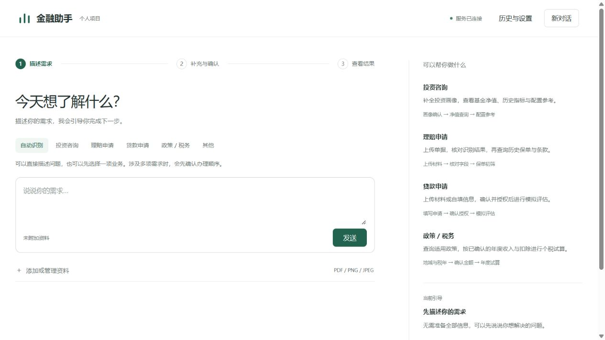
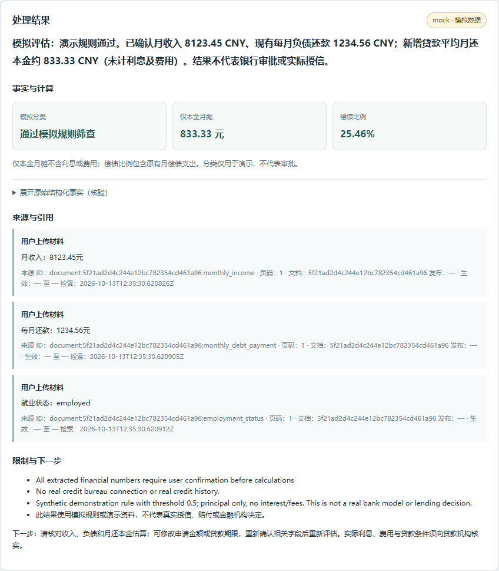
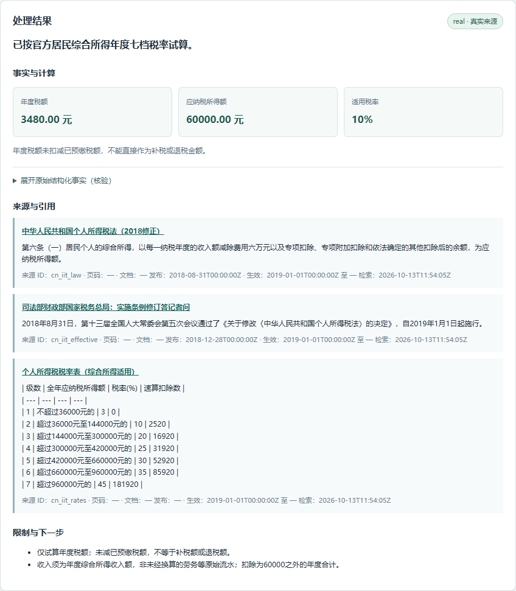
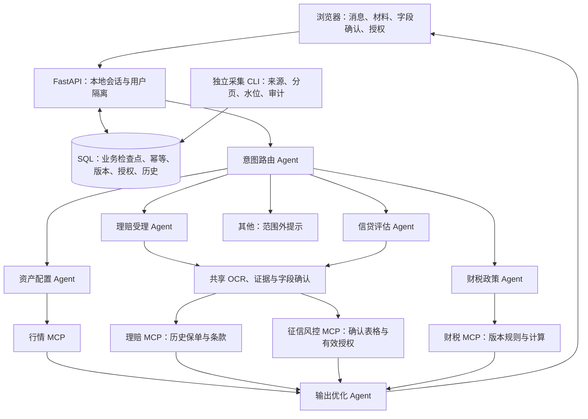

# Finance Agent · 金融多智能体工作台 🧾

[English](README.en.md) · 中文

一个可本地运行的金融业务流程个人项目。用户在浏览器中提出问题、上传材料、核对字段并确认授权；服务端用 FastAPI、LangGraph 和 MCP 串联业务，保留证据、计算过程、历史结果和恢复入口。

项目覆盖投资咨询、理赔申请、贷款申请、政策／税务、其他五类意图，由六个 Agent 和四个基于官方 Python MCP SDK 的本地服务协作。“自动识别”是入口模式，澄清和等待是工作流状态，都不增加业务意图。

当前范围是中国大陆、人民币、公开日频基金／ETF 单位净值，以及居民年度综合所得个税。保单演示和征信／风控采用明确标注的模拟数据与规则；投资配置采用可复算的类别模板。项目用于展示流程与工程实现，不提供实际授信、赔付执行或收益预测。

## 已实现功能

| 功能 | 行为与边界 |
| --- | --- |
| 路由与多轮补充 | 自动识别或手动指定五类业务；多业务问题先澄清，补答沿用原业务目标 |
| 投资画像 | 逐项确认金额、期限、风险、流动资金需求、负债、现有资产、地域与基金代码，再生成类别配置及历史净值指标 |
| 理赔材料 | 上传 PDF／PNG／JPEG，提取并确认字段，按当前用户查询历史保单版本和条款，展示保障期与条款初筛 |
| 贷款表单 | 多单据与用户提示预填，缺失／冲突追问，全部字段确认和单独授权后生成严格的 `CreditModelInput` 表格行 |
| 自填贷款试算 | 显式选择 `self_reported`，逐项确认并单独授权；结果和导出保留“未经材料核验”来源标记，仍调用模拟风控 |
| 业务复制重试 | 投资、理赔、贷款与税务的已结束运行可复制，保留材料和字段值，清空确认与授权，记录父运行；原结果保留 |
| 部分行情与字段提示 | 多代码查询逐代码检查缺失、过期和历史不足，保留可用部分；API 提供字段格式／示例，422 不回显原始输入 |
| OCR 证据 | 原生 PDF 优先读文字层，图片和无文字层扫描页使用 RapidOCR ONNX；字段保留文档、页码、原文、坐标与置信度 |
| 四个 MCP 服务 | 行情、理赔、征信／风控、财税，默认 SDK `stdio` 跨进程调用；客户端与服务端检查身份、运行归属和工具权限 |
| 财税试算 | 按地域、日期、版本检索已核验官方资料，用 `Decimal` 计算居民综合所得年度七档税额，保留引用 |
| 数据工程 | 固定公开来源、分页校验、重叠采集窗口、事务 upsert、增量水位与修订审计；失败不推进水位 |
| 恢复与隔离 | SQL 业务检查点、请求幂等、版本冲突检查、可撤销限时授权、用户隔离；历史分页、事件和 JSON／Markdown 报告 |
| 结果保真 | 结构化事实和计算保持确定性；模型仅可调整原结论的空白、分段与标点，内容变化时回退原文 |
| 本地运行 | 无前端构建步骤，提供离线只读诊断、Windows 启动脚本与代码验收脚本 |

OCR 不会自动确认金融字段，提示词也不能代替授权。金额在服务端使用 `Decimal`，在 JSON 和浏览器中保留为字符串。

## 工作台截图

2026-10-18 界面以对话为中心，上传和表单按业务阶段出现；历史、事件和恢复入口集中在“历史与设置”。以下为该版本本地浏览器验收保存的桌面首页，详细记录见[界面验收](docs/minimal-ui-verification-2026-10-18.md)。



下面保留 2026-10-13 使用合成材料的结果截图，展示计算与引用内容，界面布局属于历史版本。





## 技术栈与架构

| 层 | 当前实现 |
| --- | --- |
| 服务与契约 | Python ≥ 3.11、FastAPI、Pydantic、Uvicorn |
| 工作流与工具协议 | LangGraph、官方 Python MCP SDK 的 FastMCP／ClientSession、默认 `stdio` |
| 文档解析 | PyMuPDF、RapidOCR、ONNX Runtime、Pillow |
| 存储 | SQLAlchemy，默认 SQLite；可配置 MySQL／PyMySQL |
| 可选模型 | DeepSeek HTTP 适配、结构校验与规则降级 |
| 界面 | HTML、CSS、JavaScript，同源服务，无 Node 构建步骤 |
| 验证 | pytest、Ruff；浏览器验收使用 Playwright／Edge，需另备 Node 与 Playwright |



六个 Agent 是意图路由、资产配置、理赔受理、信贷评估、财税政策和输出优化。OCR、表单、SQL 仓储、采集任务是共享工具或基础设施。四个 MCP 服务由本项目实现，使用官方 SDK，并非金融机构提供的官方服务。

等待补充时，应用保存 SQL 业务检查点；补答校验身份、版本、确认与授权后，按原业务重入 LangGraph。当前没有使用 LangGraph 原生 `interrupt`／checkpointer。默认每次 MCP 工具调用创建独立进程，尚无连接池；`inprocess` 复用业务校验，便于调试，但不经过协议传输。

## 快速开始

需要 Git、Python 3.11 及以上和浏览器。建议使用 Python 3.13，历史完整验收环境为 Windows CPython 3.13.9。默认 SQLite，无需 Docker、MySQL 或模型密钥。首次安装依赖需要联网；图片／扫描件 OCR 还需可用的本地模型文件，首次 OCR 使用可能获取模型。

以下命令在 Windows PowerShell 7（`pwsh`）执行：

```powershell
git clone https://github.com/haihaihai112/finance-agent.git
Set-Location finance-agent
python -m venv .venv
.\.venv\Scripts\python.exe -m pip install -e ".[dev]"
Copy-Item .env.example .env
$env:LLM_ENABLED = 'false'
.\.venv\Scripts\python.exe scripts/doctor.py
.\scripts\start.ps1
```

打开[工作台](http://127.0.0.1:8000)或 [API 文档](http://127.0.0.1:8000/docs)，按 Ctrl+C 停止。指定其他端口可运行 `.\scripts\start.ps1 -Port 8001`。脚本使用项目 `.venv`，先运行诊断，阻断项通过后才启动服务。设置 `LLM_ENABLED=false` 可明确使用规则模式，不产生模型 API 请求；也可在本地 `.env` 中保存该设置。

依赖和 OCR 模型准备后，演示材料、已核验快照、规则流程与本地 `stdio` MCP 可离线运行。诊断本身只读取本地文件、包、配置与端口状态，不下载模型、写数据库或探测外部服务；诊断通过不等于 OCR 推理、模型或 MySQL 已验证。诊断支持 `--json` 和 `--port`。

其他系统可创建 `.venv`、安装相同依赖后，用对应虚拟环境解释器执行 `scripts/doctor.py` 和 `python -m uvicorn finance_agents.api.app:app --host 127.0.0.1 --port 8000`。PowerShell 启动脚本仅面向 Windows，其他系统没有同等历史验收记录。

若需复现 Windows／Python 3.13 的历史依赖环境，可用 `requirements-lock-windows-py313.txt` 安装后再 `pip install -e . --no-deps`。该文件不是跨系统、跨 Python 版本的通用锁文件。

### 配置

| 配置 | 默认与用途 |
| --- | --- |
| `LLM_ENABLED` | 默认 `true`；本地演示建议先设 `false`。没有密钥时路由明确降级为规则 |
| `DEEPSEEK_API_KEY` | 留空即可运行；仅放本地 `.env` 或环境变量 |
| `DEEPSEEK_MODEL` | 默认 `deepseek-flash`；2026-10-18 在原本机账号通过真实结构化生成、应用路由及税务整理验证；其他账号须自行核对可用性，见[历史调用记录](docs/deepseek-live-verification-2026-10-18.md) |
| `MCP_TRANSPORT` | 默认 `stdio`；`inprocess` 用于直接调用调试 |
| `DATABASE_URL` | 留空使用 `data/runtime/finance.db`；MySQL 设置见[数据库说明](docs/mysql.md) |
| `FINANCE_DATA_DIR` | 可覆盖本地运行数据与文件目录 |
| `OCR_MAX_CONCURRENCY` | 默认每进程 2；同材料并发提取复用任务 |
| `MYSQL_TEST_URL` | 仅用于专用 MySQL 集成测试库，未配置时四项真实测试跳过 |

`.env`、运行数据库、上传材料和缓存不提交到 Git。数据库与材料文件需共同备份。升级旧运行库前应备份并停止写入，由一个进程完成初始化／增量迁移后再启动多个 worker。

## 演示流程

1. 首次发送自动建立会话。展开“添加或管理资料 → 使用演示资料”，点击“创建演示资料”。操作显式创建模拟保单和收入 PDF，并导入有来源日期的 510300 净值快照；样本不会自动附加到业务，也不会自动提交或授权。“新对话”保留身份及历史。
2. **投资**：描述基金投资规划，逐项确认中国大陆、100000.00 元、12 个月、中风险、现金需求 10000.00 元、负债 0、现有资产无、基金代码 510300。查看类别配置及净值日期；快照过期时应得到不可用提示，更新后再查看指标。
3. **理赔**：勾选演示保单作为附件，核对 `DEMO-POLICY-001`、`demo-v1`、`hospitalization` 和出险日期 `2026-10-01`，确认后读取当前用户历史条款的初筛结果。上传文件不会自动创建真实历史保单。
4. **贷款**：勾选收入 PDF，核对提取的月收入 8000.00 元、月偿债支出 1000.00 元、就业状态 `employed`；自行补充申请人编号 `demo-applicant`、金额 12000.00 元、12 个月。也可显式选择“自填试算（未经材料核验）”。逐项确认后单独授权，再点“开始模拟评估”。完成后“复制为新申请”，修改金额或期限并重新确认与授权；读取原运行验证历史结果保留。
5. **税务**：确认中国大陆、2026 年、居民、年度综合所得收入额 120000.00 元、60000 元基本减除之外年度扣除 0。示例年度税额为 3480.00 元，未减预缴税额，不能直接作为补税／退税金额。
6. **其他及历史**：提出范围外问题，查看明确的范围说明；在“历史与设置”查看历史运行、读取事件，并下载已有结果的 JSON／Markdown 报告。报告保留事实、引用、资料来源和限制，不导出内部状态、凭据或授权引用。

四类金融业务均可复制为新运行；等待运行可显式取消。基金多代码请求可以返回部分结果并说明不可用代码。税务接受明确的年度综合所得同义输入，年终奖单独计税不在当前计算范围。API 的 `field_hints` 提供格式与示例。详见[体验报告修订](docs/report-revisions-2026-10-18.md)。

刷新和请求定位只读取已保存状态，不自动重放业务。每次提交保存请求 ID；响应丢失后可在“请求异常恢复”定位关联运行。超过 5 分钟无更新的请求可显式申请人工中断，服务端再次检查资格、撤销授权并拒绝迟到结果覆盖。HTTP 请求完成与业务运行完成是不同状态，等待补答的运行也可能对应已完成的 HTTP 请求。操作细节及 404／409 处理见[工作台指南](docs/workbench-guide.md)。

## 数据来源与更新

仓库包含的[已核验快照](src/finance_agents/data_jobs/verified_market_snapshot.json)通过包数据配置随 Python 包分发：基金代码 510300，16 条日频单位净值，日期范围 2026-09-14 至 2026-10-13，采集时间为 2026-10-13。它是历史样本，使用时间越晚，样本越旧。行情 MCP 检查最近 30 天新鲜度，过期后返回不可用，不继续作为当前行情提供投资指标。

需要新数据时显式联网执行：

```powershell
.\.venv\Scripts\python.exe -m finance_agents.data_jobs.scheduler market --instruments 510300
.\.venv\Scripts\python.exe -m finance_agents.data_jobs.scheduler policy --check-live
```

采集入口与 API 读取同一 `.env` 数据库。市场采集采用固定东方财富公开来源、完整分页校验、默认 7 天重叠窗口、SQLite／MySQL 原生 upsert、水位和修订审计，失败不推进水位。一次性 CLI 不自动创建计划任务；Windows 任务计划程序配置见[采集说明](docs/market-ingestion.md)。

净值不是实时 ETF 成交价；区间变化和观测最大回撤不包含分红再投资，不代表总收益或未来收益。公开接口没有可用性保证，商业接口许可和再分发授权尚未核验。数据缺失、超时或来源异常时明确失败，不补造价格。

财税规则来自已核验的国家税务总局法律、上海市税务局税率附件和司法部生效说明。固定官方来源的内容 hash 变化只进入人工审核，审核后才能导入新规则版本，不自动解释为税法变化。来源、URL、日期及核验过程见[数据来源记录](docs/data-source-validation.md)。

## 验证与限制

```powershell
.\scripts\verify.ps1
```

脚本依次执行 pytest、Ruff check、Ruff format 检查和 compileall。也可单独运行 `.\.venv\Scripts\python.exe -m pytest -q`。不需要付费模型调用；OCR 测试需要可用模型，首次模型获取可能联网。浏览器验收另需 Node、Playwright 与已安装浏览器，复现步骤见[浏览器验收](docs/browser-verification.md)。

2026-10-13 的独立 Windows／Python 3.13.9 环境历史完整回归记录为 **181 passed，4 skipped**，Ruff、compileall 和 `pip check` 通过。四项跳过均为缺少 `MYSQL_TEST_URL` 的真实 MySQL 测试。这是历史记录，不是读者环境的运行结果，也不是金融效果或性能指标。

2026-10-14 发布副本复核：独立 Windows／Python 3.13 虚拟环境按锁文件安装，完整 pytest 为 **181 passed，4 skipped（47.29 秒）**，`ruff check src tests` 通过。`doctor.py --json` 退出 0，识别默认 SQLite、`stdio` 和三个本地 ONNX 模型文件。本次没有付费模型调用，也没有真实 MySQL 验证；诊断发现模型文件不等于本次单独验证推理。测试耗时仅是该轮记录，不代表服务响应性能。

发布副本还通过 PowerShell 7.6.5 实际运行 `scripts/start.ps1`，首页、`/docs`、`/openapi.json` 均返回 HTTP 200。脚本编码兼容处理与本次复核范围见[发布说明](docs/PUBLICATION.md)。

历史验证包含实际 RapidOCR ONNX 中文 PNG／扫描 PDF 推理、四服务 `stdio` 跨进程调用、本地 SQLite、公开净值采集与重跑、Edge 浏览器工作流、授权撤销、用户隔离、版本冲突、贷款复制、请求恢复和报告下载。完整证据见[验收记录](docs/verification.md)。

2026-10-18 发布副本离线复核：**219 passed、4 skipped**；Ruff check、84 文件格式检查、compileall 及 5 项工作流视图单元测试通过。复用了启用 system-site-packages 的本机 Python 3.13.9 环境，并非干净安装；模型关闭、未复制密钥配置、外网连接被隔离。四项跳过为专用 MySQL 测试，一条警告为 TestClient 的依赖弃用提示。端口 8000 占用时诊断正确阻断，改用 8873 后退出 0。本轮不重跑付费 API 或完整浏览器流程，详见[本轮发布复核](docs/PUBLICATION-2026-10-18.md)。

仍需明确的边界：

- **外部服务**：原项目在 2026-10-18 使用合成文本完成 DeepSeek 真实调用与应用内税务流程验证；本轮发布副本不重跑付费 API，不推导代表性准确率。MySQL 有实现和专用验收入口，真实服务端到端尚未验证。
- **业务**：征信／风控为确定性模拟规则，没有真实征信连接或银行模型；理赔为条款初筛，没有申请提交或赔付执行；投资模板未做个性化基金选品。
- **OCR**：没有代表性金融数据集或准确率结论；手写、模糊、复杂表格需扩展，含文字层的 PDF 页内嵌图片正文当前不会再次 OCR。
- **身份与恢复**：本地会话是演示身份机制，尚未接企业 SSO。应用幂等与事务检查点不能等同于跨系统恰好一次执行；强制中断后不会自动重放外部工具。
- **资源与存储**：OCR 限流、缓存任务复用、运行锁回收和数据库版本控制已实现，不承诺生产吞吐量。仅有请求／历史字段的增量迁移，不是通用迁移平台；旧历史创建时间精度和真实 MySQL 时间／迁移行为有待验证。
- **检索与前端**：当前是 SQL／文本政策检索和普通网页，没有已实现的向量 RAG、Qdrant 或 React 前端。

结果中的 `real`、`redacted`、`mock` 标记说明来源类型，不证明实际业务审批完成，也不保证数据仍新鲜。

## 目录与文档

```text
src/finance_agents/
  agents/         六个 Agent
  api/            FastAPI 入口与鉴权路由
  contracts/      请求、表单、金额与结果契约
  workflow/       LangGraph、业务恢复与锁管理
  mcp_services/   四服务、stdio 与权限校验
  tools/          OCR、表单预填、材料与检索
  storage/        SQL 仓储、检查点与增量迁移
  data_jobs/      来源适配、采集、水位与打包快照
  llm/            可选 DeepSeek 适配
web/              同源浏览器工作台
tests/            Python 测试与浏览器脚本
scripts/          启动、诊断、代码和外部验收入口
docs/             架构、使用、来源与历史验证
```

| 文档 | 内容 |
| --- | --- |
| [架构与边界](docs/architecture.md) | Agent 分工、确认与授权链、MCP 协议和 SQL 恢复 |
| [工作台指南](docs/workbench-guide.md) | 材料、表单、复制、历史、报告、请求异常恢复 |
| [项目简介与工程亮点](docs/project-highlights.md) | 实现证据、工程取舍及后续扩展 |
| [数据来源核验](docs/data-source-validation.md) | 公开净值、官方税务引用及日期 |
| [采集与更新](docs/market-ingestion.md) | 增量窗口、事务、水位、修订和调度 |
| [MySQL 配置](docs/mysql.md) | 本地可选服务和专用测试库 |
| [OCR 验证](docs/ocr-verification.md) | 实际推理、字段证据及识别限制 |
| [历史验收记录](docs/verification.md) | 测试、安装、浏览器与未验证事项 |
| [发布说明](docs/PUBLICATION.md) | 2026-10-14 干净安装、代码检查、启动复核及历史说明 |
| [2026-10-18 发布复核](docs/PUBLICATION-2026-10-18.md) | 最新离线回归、环境、隔离条件及历史证据区分 |
| [浏览器复现](docs/browser-verification.md) | Playwright 命令、真实 API 与受控夹具范围 |
| [资源与外部验收](docs/resources-and-external-verification.md) | 并发测量、MySQL 与可选模型验收 |
| [个人项目验收清单](docs/personal-project-acceptance.md) | 逐业务操作与结果核对 |

## 来源说明与许可状态

项目使用 FastAPI、LangGraph、SQLAlchemy、官方 Python MCP SDK、RapidOCR／ONNX Runtime 等第三方组件；各组件遵循各自许可证。净值数据和税务原文保留来源与时间，具体证据见[数据来源核验](docs/data-source-validation.md)。本 README 不作“全部从零原创”的声明，也不把第三方组件或官方资料归为项目原创。

仓库当前没有项目级 `LICENSE` 文件，尚未声明开源许可证。公开可见不等于授予 MIT 或其他许可证；复用、修改与分发前需确认项目许可和第三方／数据来源条件。
