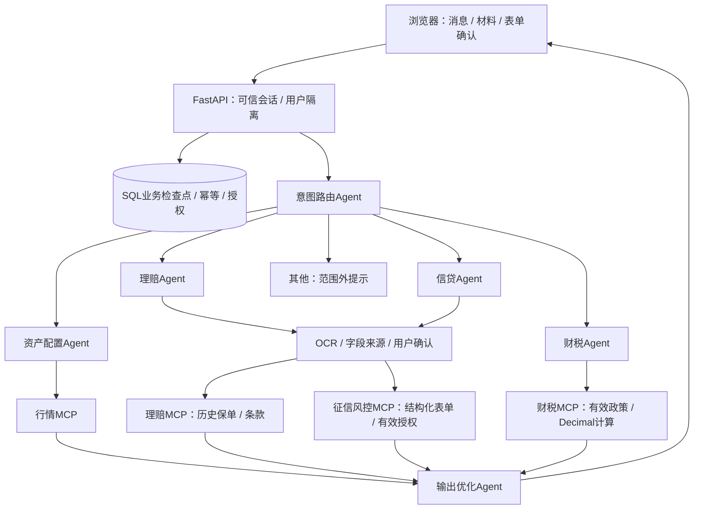

# 架构与实现边界

五类意图：investment / claim / loan / policy_tax / other。六个Agent：意图路由、资产配置、理赔受理、信贷评估、财税政策、输出优化。追问是状态，不增加意图或Agent。

专业节点返回needs_input时，状态图退出，SQL保存等待原因、表单和版本。用户补答检查所属身份、材料、字段确认、版本和授权，保存检查点后按同一业务重入图；这是应用级持久化，不是LangGraph原生interrupt/checkpointer。原税务任务文本保留，普通确认文本不会改变计算目标或政策范围。

四条链：

- 投资：缺画像追问 → 确认画像 → 公开日频净值 → 固定类别模板及历史净值变化/回撤 → 输出。比例与金额可复算；未做基金个性化选品或收益预测。
- 理赔：上传 → 原生PDF文字或扫描OCR → 保单号、版本、事故字段与金额确认 → 当前用户历史保单 → 条款初步筛查 → 输出。无条款不猜赔付，当前没有理赔提交或赔付执行。
- 信贷：多材料与提示预填 → 缺失/冲突追问 → 全字段确认 → 运行绑定、限时、可撤销授权 → 严格CreditModelInput表格行 → 模拟征信/演示偿债比例规则 → 输出。不存在真实征信查询或银行模型。
- 财税：确认大陆地域与税年 → 有效期过滤官方资料 → 必要时确认全年综合所得收入额及年度扣除 → 七档税率试算 → 引用。范围外政策不会用综合所得资料代答。

默认MCP stdio使用FastMCP和ClientSession。客户端与独立服务端验证token、run、工具白名单；风控进一步从SQL读取已确认表单，匹配输入行及当前有效授权。每调用创建一个进程，尚无连接池。inprocess模式复用同一校验但不经过协议。

金融金额使用Decimal/JSON字符串；OCR来源含页码、box、quote、置信度，冲突保留双方证据。用户确认是独立动作，授权不能由提示词生成。最终输出保留事实、计算、真实/模拟模式和引用；模型仅可调整结论空白、分段和标点，内容改变时回退原文。

政策检索是SQL地域/日期/版本过滤与有预算的文本选择，未接向量数据库，不应称为已实现向量RAG。数据库支持SQLite和MySQL仓储，首版建表用create_all，没有自动迁移。真实服务验证边界见verification.md。
